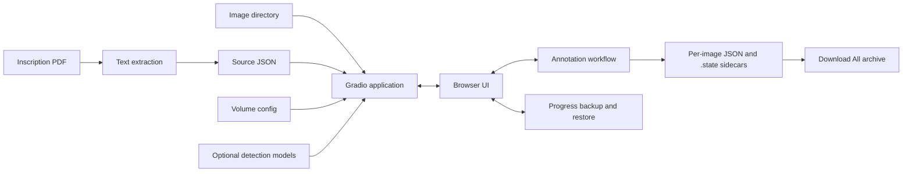

# Architecture

The repository has three main paths: a browser-based annotation workflow, optional PDF-to-JSON extraction, and optional character detection. They share configuration and data formats but can be used independently.

## Application flow

The diagram shows the logical flow. The app and workflow run in the Python server process; browser assets provide interactive editing and send state changes through Gradio callbacks.

## Main components

| Component | Responsibility |
| --- | --- |
| `gradio/app.py` | Parses CLI options, loads the selected config, resolves data paths, and launches the app. Relative config paths are resolved from the config file's directory. |
| `gradio/ui/application.py` | Creates the workflow screens and connects UI events to workflow operations. |
| `gradio/ui/presentation.py`, `gradio/ui/editor.py`, `gradio/ui/assets/` | Define the step labels, editor markup, and browser-side interaction and styling. |
| `gradio/annotation/workflow.py` | Coordinates image, content, annotation, crop, validation, and persistence operations. |
| `gradio/annotation/state.py`, `workspace.py`, `reading_order.py`, `status.py` | Hold annotation state and domain rules such as alignment, ordering, confirmation, and status validation. |
| `gradio/annotation/recovery.py` | Stores same-tab draft recovery metadata on the server side. Browser session storage is coordinated by `gradio/ui/assets/recovery.js`. |
| `gradio/annotation/progress.py` | Creates and validates portable progress backups and applies restores. |
| `gradio/annotation/io.py`, `export.py` | Read and write per-image results and create the downloadable results archive. |
| `gradio/crop/` | Edits crop coordinates and records crop geometry. |
| `fonts/` | Reference/display font assets used by extraction and browser rendering. Their redistribution terms are not recorded in the repository; verify them before repackaging or distributing the assets. |
| `helpers/text_extraction/` | Decodes PDF glyphs and generates structured source records. It does not launch Gradio. |
| `text_detection/` | Adapts optional external models and produces/fuses candidate boxes and reading order. |

## Data and persistence boundaries

- The source JSON is read as input and is not rewritten by annotation edits.
- Per-image annotations and content are written to the configured output directory. `.state` sidecars retain editor IDs, drafts, preferences, and history used to reopen a complete editing session.
- **Download All** packages completed result JSON files; it does not include editor sidecars.
- Same-tab recovery is intended for reloading the current browser tab while the application process remains available.
- **Download Progress** creates a separate versioned backup for transfer to another session or server. The backup stores data and references, not image binaries; restore checks that the target dataset and configuration match.

See [Workflow](workflow.md) for what the reviewer does at each step and [Export Format](export-format.md) for the result schemas.
